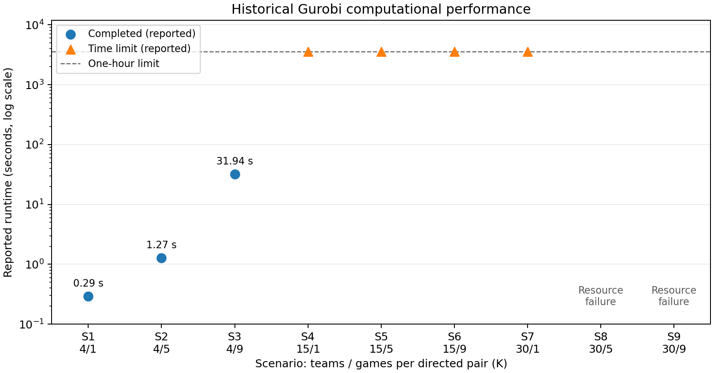

# MLB Schedule Optimization

**Integer programming · Operations research · Combinatorial optimization · Computational analysis**

A six-person Operations Research course project at National Taiwan University (May 2025). The team explored integer programming and genetic algorithms for sports scheduling; this repository focuses on mathematical programming and computational analysis, reflecting my areas of contribution.

## Overview

Scheduling a 30-team Major League Baseball (MLB) season requires substantial travel between stadiums. We investigated how to minimize estimated travel costs while satisfying game assignment and matchup requirements. Our computational experiments examined how the tractability of integer programming changes as the number of teams and required games increases.

## My Contributions

- Collaborated on defining the MLB scheduling problem and researching scheduling requirements.
- Co-implemented a binary integer programming model in Python using Gurobi, including game assignments, venue indicators, and movement-cost constraints.
- Participated in discussions on mathematical formulation, transportation cost assumptions, and home-and-away matchup requirements.
- Collaborated on evaluating the computational performance of optimization approaches across problem sizes.

Other team members handled stadium data collection, distance calculations, scenario generation, genetic algorithm implementation, and historical schedule cost estimation. The reported experimental results are team-level outcomes.

## Problem Abstraction

The initial problem considered MLB-specific matchup frequencies, home-and-away allocations, rest days, and series restrictions. Detailed scheduling and venue-movement constraints introduced substantial computational demands. To facilitate controlled experiments, we explored a parameterized tournament model with $N$ teams and $K$ games per directed matchup, allowing problem size and matchup requirements to vary systematically.

The available Gurobi implementation demonstrates the simplified problem for even $N$ over $T=2K(N-1)$ days, with no rest days. It is not a full MLB season solver.

## Mathematical Programming Approach

The binary model represents game assignments $x_{ijt}$, venue locations $l_{ipt}$, and movements $m_{ipqt}$ between venues on consecutive days. Its objective is to minimize estimated travel costs:

$$\min \sum_{i,p\ne q,t\ge 1} C_{pq}m_{ipqt}.$$

The constraints enforce daily participation, directed matchup counts, venue consistency, and movement linearization. Travel costs are estimated from stadium coordinates using Haversine distances and bus/air transport assumptions. See the [mathematical formulation](docs/mathematical_formulation.md) for details.

## Notebooks

| Notebook | Focus |
|---|---|
| [01 — Travel Cost Model](notebooks/01_travel_cost_model.ipynb) | Calculate stadium distances and estimated transportation costs |
| [02 — Integer Programming](notebooks/02_integer_programming.ipynb) | Gurobi implementation, solver status, objective bound, MIP gap, and schedule checks |
| [03 — Computational Analysis](notebooks/03_computational_analysis.ipynb) | Analyze reported runtimes and scaling limitations |

The optimization model is implemented in [`src/integer_programming.py`](src/integer_programming.py).

## Computational Findings

The original course report documented nine Gurobi experiments using 4, 15, or 30 teams and 1, 5, or 9 required games per directed matchup ($K$).

| Teams | K | Reported runtime (s) | Reported outcome |
|---:|---:|---:|---|
| 4 | 1 | 0.29 | Completed |
| 4 | 5 | 1.27 | Completed |
| 4 | 9 | 31.94 | Completed |
| 15 | 1 | 3,600 | Time limit; reported incumbent |
| 15 | 5 | 3,600 | Time limit; reported incumbent |
| 15 | 9 | 3,600 | Time limit; reported incumbent |
| 30 | 1 | 3,600 | Time limit; no reported feasible solution |
| 30 | 5 | — | Resource failure |
| 30 | 9 | — | Resource failure |



The four-team runs completed in under 32 seconds, whereas the larger instances reached the one-hour time limit or encountered resource failures. These observations illustrate the computational challenges of scaling integer programming to larger scheduling problems.

See the [reported results](results/reported_gurobi_results.csv) and [methodology and limitations](docs/methodology_and_limitations.md).

From an operational perspective, these findings highlight the importance of balancing travel cost minimization with computational tractability. While integer programming provides a systematic framework for evaluating scheduling alternatives, large-scale league scheduling may require decomposition or heuristic approaches to obtain feasible schedules within practical computational limits.

## Running the Notebooks

Install dependencies in an isolated environment:

```bash
pip install -r requirements.txt
pip install gurobipy
```

Gurobi requires a suitable license. Open the notebooks from the repository root or the `notebooks/` directory. Notebook 02 uses a synthetic four-team example, which has not been rerun in the current environment; notebooks 01 and 03 do not require Gurobi.

Run the supplementary schedule-validation tests from the repository root:

```bash
python -m unittest discover -s tests
```

## Repository Scope and Reproducibility

The computational results are drawn from the original course experiments. The repository includes a Gurobi implementation for simplified even-team scheduling problems, together with supplementary schedule-validation utilities and a synthetic example.

The synthetic example illustrates the optimization workflow rather than reproducing the original benchmark experiments, for which the exact input data are unavailable.

See [data sources and assumptions](data/README.md) for details.
